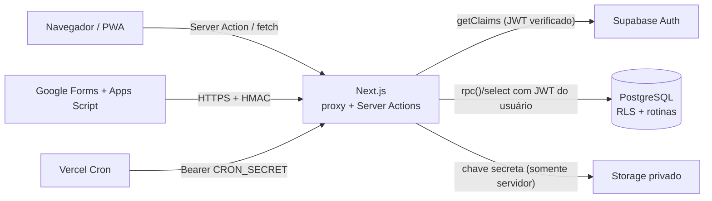

# Arquitetura — visão geral

## Camadas

| # | Camada | Onde | Responsabilidade |
|---|---|---|---|
| 1 | Apresentação | `src/app`, `src/components`, `src/features/*/*.tsx` | Telas, formulários, simulações (nunca valores oficiais) |
| 2 | Autenticação | `src/proxy.ts`, `src/server/auth/session.ts` | Sessão Supabase verificada (`getClaims`), MFA (AAL2) |
| 3 | Autorização | `src/server/authorization`, `src/lib/permissions.ts`, RLS | Papel, escopo de carteira, conta ativa |
| 4 | Validação | `src/lib/validation` (Zod) + CHECKs/rotinas no banco | Entrada validada no cliente, no servidor e no banco |
| 5 | Serviços/regras | `src/features/*/actions.ts`, `src/server/services`, funções `public.*` no PostgreSQL | Operações de negócio |
| 6 | Persistência | PostgreSQL (Supabase) | Fonte oficial dos dados |
| 7 | Integrações | `src/server/integrations`, `scripts/google-forms` | Google Forms (HMAC), Storage |
| 8 | Auditoria | `audit_logs` + `private.log_audit` + triggers | Trilha imutável |
| 9 | Tarefas recorrentes | `public.run_daily_jobs()` + Vercel Cron | Mensalidades, atrasos, notificações, retenção |
| 10 | Monitoramento/erros | `src/server/logger.ts`, `src/server/errors.ts`, `x-request-id` | Log JSON estruturado, erros seguros |

## Princípio central

**Toda escrita sensível é uma rotina transacional no PostgreSQL** (`SECURITY DEFINER`,
`search_path` vazio, autorização explícita no início). O Next.js valida a entrada,
autentica e chama a rotina **com o JWT do usuário** — assim `auth.uid()` identifica
o ator dentro do banco, a RLS continua valendo nas leituras e uma falha no meio da
operação desfaz tudo (atomicidade). O navegador nunca calcula valores oficiais nem
decide privilégios.

## Ambientes

Três projetos Supabase e três ambientes Vercel separados: **development**,
**staging (homologação)** e **production**. Dados de demonstração existem apenas
em `supabase/seed.dev.sql`, que se recusa a rodar fora de um banco local.

## Por que não usar a chave secreta para tudo?

A chave secreta ignora RLS. Ela só é usada em quatro pontos, todos após
autorização explícita: convites (`auth.admin`), Storage (upload/URL assinada),
ingestão do Google Forms (após HMAC) e rotina diária (após `CRON_SECRET`).
