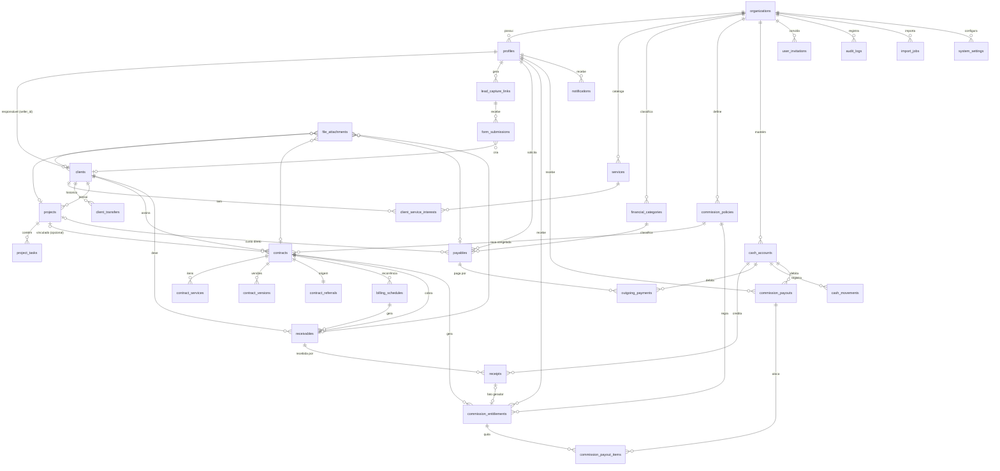

# Relacionamentos (ER)

Relacionamentos indiretos relevantes:

- `cash_movements.source_type/source_id` aponta para `receipts`, `outgoing_payments`,
  `commission_payouts` ou para o id de uma transferência — validado pelas rotinas (não aceito do cliente).
- `financial_adjustments.source_*` aponta para o registro estornado/anulado.
- O vendedor da comissão é `contracts.seller_id` (vendedor da venda), **não** o responsável atual do cliente.
